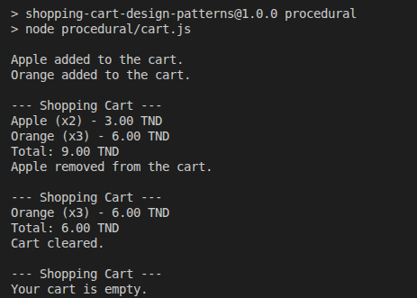
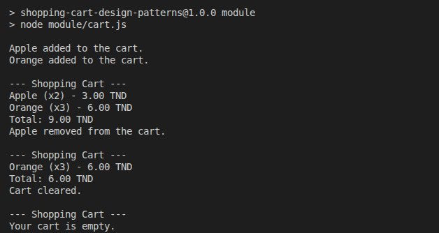

# GMC Shopping Cart System

A simple shopping cart application built with JavaScript, demonstrating procedural programming and the Module Pattern.

## Features

- Add items with name, quantity, and price.
- View cart items and total price.
- Remove items by name.
- Clear the shopping cart.

## Implementations

### Part 1: Procedural Programming

Uses a global cart variable and standalone functions to manage shopping cart operations.

### Part 2: Module Pattern

Uses an IIFE and closure to encapsulate cart data and expose public methods.

## Reflection

See [REFLECTION.md](REFLECTION.md) for the challenges, improvements, and lessons learned.
